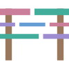

# syntax-highlighter-bench

[](https://syntax-highlighter-bench.ryanatkn.com/)

> benchmark suite and results site for JS syntax highlighters

This project aims to comprehensively benchmark
[Twinkleplop](https://twinkleplop.pngwn.at/),
[Prism](https://prismjs.com/),
[Shiki](https://shiki.style/),
[fuz_code](https://github.com/fuzdev/fuz_code) (same author as this project),
and other syntax highlighters.
The [website](https://syntax-highlighter-bench.ryanatkn.com/) has more.

**Status: early.** The adapters, the corpus, the check that guards against a
plain-text fallback, the harness that times the libraries, warm and from a cold
start, and writes a results file, the deterministic measurements (bundle size,
install footprint, retained heap, token counts, output sizes raw and compressed,
coverage), and the site that renders a results file exist. The deterministic
numbers are committed as `results/deterministic.json`. A timed run is
published as `results/latest.json`, measured on one named machine, and the site
renders it.

AI disclosure: this is an LLM-generated repo guided by a person.

## Quick start

Prerequisites:

- **Node >= 24.14.** The check workflow pins Node 24.14, and the committed
  deterministic file is generated on it: its gzip and brotli sizes come from
  the zlib and brotli inside Node, and its retained heaps from V8's object
  layout, on x64.
- **Linux, for timed numbers.** The harness reads the CPU's frequency settings
  from `/sys/devices/system/cpu/`, and reads peak memory as kilobytes, which is
  Linux's unit. Everything else, the site and the deterministic file included,
  is plain Node.

```bash
npm ci                                  # install exactly the locked versions
gro check                               # typecheck, test, lint, format check
npm run bench:deterministic -- --check  # the committed deterministic file still regenerates
npm run bench:smoke                     # every library on every cell and cold-start scenario once
node bench/run.ts --machine <name> --plan  # what a full run would do, measuring nothing
```

The smoke run proves the harness and every adapter work on this machine, and
checks every process against the committed deterministic file. Its numbers mean
nothing, and its file goes to `results/scratch/`.

## Network and disk

After `npm ci`, everything runs offline: `gro check`, `gro build`, the corpus
checks (`corpus:check`, `corpus:stress -- --check`), `bench:deterministic` and
its `--check`, the smoke run, `--plan`, and timed and cold-start runs. The
corpus is committed, so nothing is downloaded to measure it.

What needs more:

- `npm ci` needs the network.
- `npm run corpus:fetch` re-downloads neutral inputs from their pinned upstream
  commits, so it needs the network.
- `npm run corpus:harvest` rebuilds the synthetic large Svelte input from local
  checkouts of the projects it harvests (`--repos <dir>`), not from the network.

`gro build` runs `npm install` first by default, which succeeds offline when
`node_modules` matches the lockfile; `gro build --no-install` skips it. Never
run `npm i` in this repo: it can rewrite the lockfile, which moves the install
closures the deterministic file records. Use `npm ci`.

Disk: `node_modules` takes under 200 MB, and the harness adds a few tens of MB
of cache under it, at `node_modules/.cache/syntax-highlighter-bench/`: the
built bundles that are measured and imported, and the generated modules of the
cold-start and retained-heap processes. Open a bundle there to see exactly what
was measured.

## What is measured

Two classes of number, kept apart in the results file. The site's docs say
what each is in full.

**Machine-dependent**, published only from one named machine:

- **Throughput**, per input in two modes, `tokenize` (tokens out) and `html`
  (the HTML string a consumer ships), with each process's peak memory beside
  it: [`/docs/method`](https://syntax-highlighter-bench.ryanatkn.com/docs/method)
- **Cold start**: a fresh Node process that imports a library and does one
  thing, against a bare Node baseline:
  [`/docs/method`](https://syntax-highlighter-bench.ryanatkn.com/docs/method)

**Deterministic**, the same anywhere, in the committed
`results/deterministic.json`, all described at
[`/docs/deterministic`](https://syntax-highlighter-bench.ryanatkn.com/docs/deterministic):

- **Bundle size** for each feature set, minified, gzip and brotli, with the
  wasm binary and the theme CSS reported apart from the JS
- **Token counts**, each library's own
- **Output sizes**, the HTML raw and compressed
- **Retained heap** after loading one language and highlighting once: V8's
  heap, its machine code, and external memory, for the Node version the check
  workflow pins
- **Install footprint**: the packages, files, and bytes `npm install` of a
  library adds
- **Coverage**: which library claims which language
  ([`/docs/languages`](https://syntax-highlighter-bench.ryanatkn.com/docs/languages)
  has the language ids and the feature sets)

A language a library doesn't claim is _unsupported_, and a claimed one whose
output fails the pre-measurement check is _excluded_. The two are recorded
differently, and neither is ever a zero.

## Running on your machine

A timed run is long: hours. `--plan` estimates a full run from its parameters.
A calibration measures every cell twice, so it takes about twice the cells'
time. The estimate assumes calls shorter than a batch, so it misses Shiki on
the long-line stress inputs, where a call takes seconds: those cells add tens
of minutes it doesn't show.

1. `npm ci`, from a clean tree at the commit to measure.
2. `npm run bench:deterministic -- --check`. A full run with no filters is
   refused unless the deterministic file describes it; if the check fails,
   regenerate with `npm run bench:deterministic`.
3. `npm run bench:smoke`, so a disagreement stops a short run and not the long
   one.
4. Quiet the machine:
   [results/README.md](results/README.md#quieting-the-machine) has the
   protocol.
5. `npm run bench:calibrate -- --machine <name>`: the machine's noise floor,
   written to `results/calibration_<name>.json`. A run without one carries no
   noise floor, so it is never publishable, and a difference between libraries
   can't be told from noise.
6. `npm run bench -- --machine <name> --plan`, and read it: the noise floor and
   the bundle sizes must say they are carried, and the commit must have no
   `-dirty`.
7. `npm run bench -- --machine <name>`: a full run, written to
   `results/<UTC date>_<name>.json`.
8. If it stops, `npm run bench -- --machine <name> --resume`.

`node bench/run.ts --help` lists every flag. A full run measures each library
in 3 processes per cell, each timing 4 rounds of 20ms batches, after a 100ms
warmup, with a 300ms rewarm before each batch (none when one call takes longer:
the batch before keeps it warm), and keeps 20 samples of each
scenario, after 3 discarded rounds (`--help` prints the defaults). Filters
(`--libraries`, `--langs`, `--sizes`, `--modes`, `--sources`, `--metrics`)
narrow a run, and a filtered or smoke run is written to `results/scratch/`,
which git ignores.

**Stopping and resuming.** A timed run appends every process's result to a
journal beside its results file, synced before the next process starts. When a
run stops, by a signal, a failed process, or a crash, the journal stays, and
`--resume` continues it, skipping what the journal holds. A resume is refused,
naming the difference, unless it is the same run: the flags, corpus, library
versions and extra packages, machine and its frequency settings, kernel
release, Node version, `NODE_OPTIONS`, and commit. A journal already there stops a run that wasn't
given `--resume`. A run during which a measured package changed on disk sets
its journal aside as `.changed`, and one that lost the machine lock as
`.overlapped`; neither can be resumed, so delete it and start over.

**The machine lock.** One measurement at a time, machine-wide: a run holds
`/tmp/fuz_benchmark.lock` while it measures, and a second is refused and told
who holds it. It is fuz_util's benchmark lock, so any other benchmark that uses
it can't measure at the same time as this one.

## Publishing

A run is published by copying it to `results/latest.json`, which the site
renders, with `npm run results:publish -- results/<UTC date>_<name>.json`. It
refuses a file that isn't publishable: a full, unfiltered run with no gap, a
stable anchor, a noise floor, and a clean commit. [results/README.md](results/README.md)
has the whole procedure: the files in `results/`, the publishing machine,
quieting it, the commands in order, and the checks to read before committing.

## Method in brief

[`/docs/method`](https://syntax-highlighter-bench.ryanatkn.com/docs/method)
has the method in full, with what each number means.

**A process for each library.** A cell is one input in one mode. A process
measures one library on one cell and loads no other, so no library can move
another's number: libraries that share code (Shiki's two engines) change how V8
optimizes it for each other, and V8 sizes its young generation from recent
allocation, so a time depended on what ran beside it. The process sets up
exactly the cell's language, checks the output, calibrates its iterations, and
times its rounds, each after a rewarm (unless one call outlasts it) and a minor
collection (no full collection is forced between rounds). The last result of
each batch is counted after the clock stops, and in `html` mode one character
of the string is read inside it, so a string the engine hasn't flattened is paid
for.

**Passes and rotation.** Each library is measured on a cell in several
processes, and its number pools the rounds of all of them, since the same code
can settle at a different speed from one process to the next. The library a
pass starts with rotates from pass to pass and cell to cell. One process runs
at a time, and the parent does nothing while it measures.

**Retries.** A library whose rounds on a cell disagree past a threshold is
measured again, every pass, a bounded number of times. The attempt kept is the
one with the lowest spread, never the fastest, which would bias retried numbers
toward fast and favor a noisier library. `attempts` records it.

**The anchor and the noise floor.** A fixed workload with no measured library
is read before and after every segment of a run; drift past the threshold means
the machine changed state, and the run is measured again. A calibration
measures every library as two independent arms, and how far they are apart is
the noise floor a full run carries.

**Cold start.** Each sample is one fresh Node process, with no flags and the
compile cache off, that imports a library's bundle entry (the same module whose
size is reported) bundled or unbundled, and for a first highlight highlights
one snippet. Its time is the process's own clock from its start, and `bare`,
the same process importing nothing, is what a reader subtracts. Scenarios are
interleaved round by round with a rotating order, the first rounds are
discarded, and nothing is retried.

## Caveats

- Shiki resolves colors while tokenizing and writes them inline; the others
  emit classes. The `html` mode measures what each library ships, which is not
  the same work.
- The libraries differ in features and in fidelity: how finely each splits
  the same source, and how accurately it classifies each part. The numbers
  time each library's output without scoring its quality.
- Token counts differ between libraries, and fewer tokens is less work, not
  faster work.
- In a cell every library is warm, and just rewarmed after a minor
  collection. What a first call costs is in cold start.
- A cold-start time is a Node process with its files in the page cache. A
  browser parses, compiles, and fetches differently; there the bundle sizes
  matter instead.
- A library is measured alone. A page that loads several highlighters gives the
  engine a different history.
- A timed process loads only the language it measures, so fenced code inside
  Markdown is mostly not highlighted
  ([`/docs/adapters`](https://syntax-highlighter-bench.ryanatkn.com/docs/adapters)
  lists the exceptions). A site that loads several languages pays more for
  Markdown.
- Some inputs are a library's own samples, and some are stress inputs built to
  find worst cases. Both are labeled, summarized on their own, and kept out of
  the default view and the headline figures, which use the neutral inputs.
- A few inputs were built by joining, repeating, or minifying files, and are
  marked synthetic.
- Shiki stops tokenizing a line after its time limit and returns the rest as
  one token, so what a call returns would depend on the machine's speed. Both
  Shiki adapters raise the limit out of reach, so every call does the same
  work: a consumer with default options gets a plain-text fallback on a line
  that slow, not the number measured here.
- The numbers are one machine's, on Node. Compare the ratios between libraries
  before the absolute times.

## Corpus

Every input is a file under `bench/corpus/`, labeled by where it came from:

- `neutral` — real files from projects no measured library authored, pinned to
  an upstream commit: the primary set
- `shiki` — the samples Shiki's own benchmark uses
- `home` — a measured library's own samples, labeled as its home turf
- `harness` — one short, syntax-dense snippet per language, written here
- `stress` — neutral inputs minified, and pathological files (deep nesting,
  very long lines, unterminated constructs, runs of delimiters that never
  close) generated by `bench/corpus_stress.ts`

Inputs fall into size tiers by their byte size: `micro` under 600 B, `small`
under 3,200, `medium` under 32,000, and `large` above. The manifest records
each input's hash and pins (repository, commit, path, license), and a run
records a hash over the whole corpus. Never edit a file there: replace it and
update its pin. [bench/corpus/README.md](bench/corpus/README.md) has the
details, [bench/corpus/INPUTS.md](bench/corpus/INPUTS.md) lists every input,
and [`/docs/corpus`](https://syntax-highlighter-bench.ryanatkn.com/docs/corpus)
describes the sources.

```bash
npm run corpus:check              # the manifest matches the files, and every copy its pin
npm run corpus:manifest           # regenerate the manifest and INPUTS.md after adding an input
npm run corpus:stress             # regenerate the stress inputs, then the manifest
npm run corpus:stress -- --check  # the stress inputs are what generates
npm run corpus:fetch              # re-download missing or changed neutral inputs (network)
npm run corpus:fetch -- --check   # download every neutral input and compare, writing nothing
npm run corpus:harvest -- --repos <dir>          # rebuild the synthetic large Svelte input
npm run corpus:harvest -- --repos <dir> --check  # fail if it would change
```

## Adding a library

[`/docs/adapters`](https://syntax-highlighter-bench.ryanatkn.com/docs/adapters)
has the adapter rules and what each adapter calls. The steps:

1. **Propose the devDependency** and wait for approval: this project keeps its
   dependencies tight, and every measured library is one. Install it with
   `npm install --save-dev`, which updates the lockfile on purpose.
2. **Write `bench/libraries/<id>/adapter.ts`**, exporting a
   `HighlighterAdapter` (`bench/adapter.ts` documents each member), and
   `notes.md` beside it: which entry points it calls, why they are the same
   stage as the other libraries', and what one token is.
3. **Add it to `ADAPTERS`** in `bench/libraries.ts`.
4. **Record every package it is measured with.** Packages versioned apart from
   `package` (per-language packages, a theme package) go in `extra_packages`; a
   test fails when a stylesheet or wasm binary comes from a package that isn't
   recorded.
5. **The theme**: `theme_css` lists the default stylesheets a consumer imports,
   or is null when styles are inline, and `theme_schemes` says which color
   schemes that theme covers.
6. **Wasm**: `wasm` names each binary the library loads, as the import that
   inlines it and the binary's own specifier.
7. **The bundle**: `bundle_entry` writes the module a consumer would, with
   exactly the given languages, in the library's documented shape;
   `bundle_html` highlights through that module's exports; and
   `bundle_html_source` is the same call as an expression, which cold start
   runs. Add the library's row to the bundle-shape table of the deterministic
   docs page (`src/routes/docs/deterministic/+page.svelte`).
8. **Clear the snippet gate** on every language it claims: `check_output` on
   the language's harness snippet must reach the floor of distinct span kinds.
   The tests run it on every claimed language and every corpus input, so a
   library that would be excluded somewhere fails the suite first.
9. **A missing timed language.** The timed ids are those every roster library
   supports, and a test fails when an adapter lacks one. A library without one
   either isn't added, or that language becomes untimed (`timed: false` in
   `bench/langs.ts`): it then has no timed cells, cold-start language scenarios,
   or retained heaps for any library, which changes the method, so the docs
   that name the timed languages change with it.
10. **Regenerate** with `npm run bench:deterministic`, and commit
    `results/deterministic.json`: the new library adds bundle sizes, counts,
    heaps, and a footprint, and the lockfile change can move another library's
    install closure.

The results file carries the roster, so the site needs no change. A
calibration made before the change no longer describes the roster, so a full
run won't carry its floor: calibrate again. A published run is then shown as a
snapshot that says the library was added, until a new run replaces it.

## The site

A static site prerendered from one results file: `results/latest.json`, the
published run, when it exists, and otherwise `results/deterministic.json`, in
which case the timed sections say that no timed results are published. The file
is parsed through the schema at build time, so a malformed or unpublishable one
fails the build. [`/docs/results`](https://syntax-highlighter-bench.ryanatkn.com/docs/results)
describes the file and what the site renders.

`src/test/fixtures/results/fixture_run.json` is a complete run with invented
numbers, for the tests and for working on the timed views.
`BENCH_RESULTS_FIXTURE=1 gro build` renders it, with a banner on every page:
"fixture data — invented numbers, not measurements". Without the variable it is
never read.

The check workflow (`.github/workflows/check.yml`) runs `gro check` with the
build, `bench:deterministic -- --check`, and the smoke run on every push to
`main`, every pull request, and on demand. None of it measures speed.

## Layout

- `bench/` — the harness. It runs on Node directly, through type stripping,
  and is never imported by the site.
  - `bench/adapter.ts` — the contract every library is driven through
  - `bench/libraries.ts` — the roster, and `bench/libraries/<id>/` — one
    adapter per library, with notes on the entry points it uses
  - `bench/check_output.ts` — the check each library passes before it is measured
  - `bench/run.ts` — the timed harness: a run, written as one results file
  - `bench/cell.ts` — one library on one cell, measured in a process of its own
  - `bench/coldstart.ts` — the cold-start scenarios, and the process that takes
    one sample
  - `bench/journal.ts` — the journal a timed run keeps, so it can be resumed
  - `bench/publish.ts` — makes a publishable run `results/latest.json`
  - `bench/deterministic.ts` — the deterministic results file, from
    `bench/sizes.ts` (bundle size), `bench/install.ts` (install footprint),
    `bench/heap.ts` (retained heap), and `bench/outputs.ts` (token counts and
    output sizes)
  - `bench/corpus/` — the inputs, with their manifest
  - `bench/corpus_stress.ts` — generates the stress inputs
  - `bench/langs.ts` — the language ids every adapter maps onto
  - `bench/sets.ts` — the feature sets bundle size is measured over
- `results/` — where the harness writes runs; `deterministic.json`, the
  published run as `latest.json`, its dated file, and the machine's calibration
  are committed. [results/README.md](results/README.md)
  says what each file is and how a run is published
- `src/lib/results_schema.ts` — the schema of a results file, written by the
  harness and parsed by the site
- `src/lib/` — besides the schema, the modules and components that turn a
  results file into the tables of the site
- `src/routes/` — the site, static SvelteKit: the landing page (the headline
  figures as charts, what they mean in practice, and what each language costs),
  `/results`, and the docs under `/docs` (`src/routes/docs/`)

## Neutrality

The maintainer of this benchmark also maintains fuz_code, so fairness has to be
structural. By design:

- the maintainer's library is flagged in the results file and on the site
- every input is labeled by its source — real code no measured library
  authored, Shiki's own benchmark samples, a library's own samples, or a
  snippet written for this benchmark — and the first is the primary set
- each adapter documents the entry points it uses, so a library's maintainers
  can review or replace it
- the method and the commands to reproduce a run are published with the numbers

## Credit

The measurement method builds on the comparison harness of
[Twinkleplop](https://github.com/pngwn/twinkleplop) (MIT). Kept from it: a
fresh process for each cell, iterations calibrated per library, language
binding kept out of the timed loop, an untimed rewarm and a minor collection
before timing, token counts recorded, a check before measuring that excludes a
library returning nothing (and records it as excluded), machine drift detected
by an anchor workload, ported from it, and a machine-wide lock (here
fuz_util's, which Twinkleplop's runs don't share). The first adapter rules come
from the same harness: the same stage, explicit languages with no fallback, and
token counts recorded rather than equalized. So do Shiki's two engines measured
as two libraries, Shiki's benchmark samples as an input source, and the `docs`
feature set, fixed before any numbers. The calibration follows Twinkleplop's
A/B harness: an A/A run whose 95th-percentile deviation is the floor for one
cell, with a separate floor for a geometric mean. Changed here: Twinkleplop measures a
cell's libraries together in one process, alternating within each round, and
this harness gives each library a process of its own, rotates the order of the
processes, pools several passes, forces no full collection before a batch
(Twinkleplop's forces one every round), and reads the HTML inside the timed
call.

Cold start generalizes Twinkleplop's cold-start harness across libraries. Kept
from it: a fresh process for each sample, scenarios interleaved round by round,
the first rounds discarded, the compile cache off, the bundled chunk measured
against the unbundled import, a bare Node baseline, time to a first highlight,
medians rather than means, and the machine lock. Changed here: the scenarios
run for every library through the adapters' bundle entries; a time is the
process's own clock from its start, read once when the scenario's work is done,
where Twinkleplop reads that clock between each step and also reports a wall
time measured by the parent, spawn included; the process is a generated module
with no harness code; the library that goes first rotates; every sample is
checked; and the samples are journaled as part of a run. Its scenarios that are
about Twinkleplop's own internals (a stubbed compiler, the cost of binding a
language, shipping a compiled grammar, the compile cache turned on) are not
here.

Statistics and formatting come from
[fuz_util](https://github.com/fuzdev/fuz_util).

The corpus holds files from other projects, each under its own license:
see [bench/corpus/README.md](bench/corpus/README.md).

## Develop

Requires Node >= 24.14.

```bash
npm ci      # install exactly the locked versions; never `npm i`, which can rewrite the lockfile
npm run dev # or `gro dev`
gro check   # typecheck, test, lint, format check
gro build   # build the static site
gro build --no-install # build it without the install `gro build` starts with
BENCH_RESULTS_FIXTURE=1 gro build # build it over the fixture run: invented numbers, marked on every page
gro format 'bench/**/*' # format the harness, which `gro format` alone doesn't reach
npm run bench:smoke     # run every library on every cell and cold-start scenario once
npm run bench:deterministic -- --check  # the committed deterministic results still regenerate
```

Built with [SvelteKit](https://github.com/sveltejs/kit),
[Svelte](https://github.com/sveltejs/svelte),
[fuz_ui](https://github.com/fuzdev/fuz_ui),
[fuz_css](https://github.com/fuzdev/fuz_css), and
[Gro](https://github.com/fuzdev/gro).

## License

[MIT](LICENSE)
